# BL62 Label GUI — User Manual

English edition: October 26, 2026

Application release: Current date-based Windows release; verified 2026-10-26

English interface title 2026-10-21; shared core includes later import/histogram updates. Release and GitHub copies match the active application files.

## 1. Purpose and Interface

BL62 Label GUI creates instance masks for scientific images. Review automatic SAM3 detections, correct masks manually, save the working COCO project, and export a portable dataset.

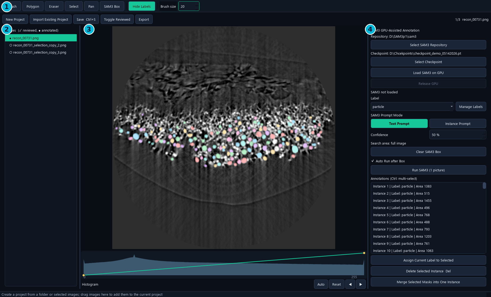

- The Label dropdown supplies both the category name and the SAM3 text prompt.
- The single Run SAM3 button serves one selected image or multiple selected images.
- The image list uses a check mark for reviewed images and a filled dot for images with annotations.

## 2. Installation and First Launch

Use the complete Windows release folder. The Label application and SAM3 dependencies run in the dedicated Windows environment; model weights remain external.

1. Install an NVIDIA driver and Miniforge/Conda on the target Windows computer.
2. Extract the release to a local, writable folder and run install_windows.bat.
3. Wait for installation and the installation-time CUDA/GPU checks to finish.
4. Launch BL62 Label GUI.vbs, or use the BL62 Label GUI desktop shortcut.
5. If needed, run create_shortcut.ps1 to create the shortcut.

| Requirement | Purpose |
| --- | --- |
| Windows 10/11; NVIDIA GPU | GPU-assisted SAM3 annotation |
| BL62_Label_GUI Conda environment | GUI and SAM3 Python dependencies |
| SAM3 repository and compatible checkpoint | External inference source and model weights |
| Writable dataset and export locations | Project JSON, cache and exported files |

**Note.** There is no SAM3 Setup / GPU Test dialog in the current GUI. Repository and checkpoint selection are separate buttons on the right.

## 3. Configure SAM3 and the Checkpoint

Select the local SAM3 source and an inference-compatible checkpoint before running predictions.

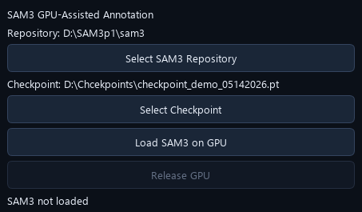

1. Click Select SAM3 Repository. Choose the repository root containing pyproject.toml and sam3/__init__.py.
2. Click Select Checkpoint and choose the intended model file.
3. Confirm that both paths shown on the right are correct.
4. Run SAM3 directly, or use Load SAM3 on GPU to preload it.

```text
Shared workstation checkpoint:
D:\Chcekpoints\checkpoint_demo_05142026.pt
```

**Note.** The Chcekpoints spelling is intentional. sam3_settings.json stores this application's local selection; checkpoints are not included in the application release.

## 4. Model Residency, Release and Cancel

The first SAM3 operation loads a persistent background worker. Later operations reuse the loaded model until it is released or its configuration changes.

- Idle model residency allows editing, image switching, saving and exporting. It continues to occupy GPU memory.
- An active load/inference uses a modal progress window, so editing is temporarily blocked while that operation runs.
- After cancelling, wait for the progress window to close. The next SAM3 operation reloads the model.

| Action | Current behavior |
| --- | --- |
| First Run / Load SAM3 on GPU | Loads the model; later runs reuse it |
| Change Label, prompt mode or confidence | Keeps the current model loaded |
| Change repository or checkpoint | Reloads an already loaded model |
| Release GPU | Unloads the worker; next Run loads again |
| Cancel active SAM3 task | Terminates the worker and releases its GPU memory |
| Close the application | Stops the resident worker |

**Note.** GPU residency removes repeated model-loading overhead. It does not make the inference computation itself disappear.

## 5. Create, Import and Add Images

1. Use New Project to choose an image folder or selected image files.
2. To continue an existing project, click Import Existing Project and select annotations.json.
3. Drag images into an empty window to start a project; drag them into an open project to add images.
4. Wait for image indexing and background preparation to complete.
5. Navigate by clicking the image list or using Previous / Next beside Histogram.

| Operation | Select |
| --- | --- |
| New Project | Folder or supported images |
| Import Existing Project | COCO annotations.json |
| Add images | Drop additional image files into the existing project |
| Remove from Project | Select list entries, then use the right-click menu |

**Note.** Remove from Project removes project references and their annotations; it keeps image files on disk. Import cancellation stops preparation and keeps the previously open project. Successful import is reported in the status bar, without a Save Complete popup.

## 6. 8-bit, 16-bit and 32-bit Images

The source file keeps its native pixel values and bit depth. Masks use the original image dimensions and pixel coordinates. The canvas renders a prepared display preview.

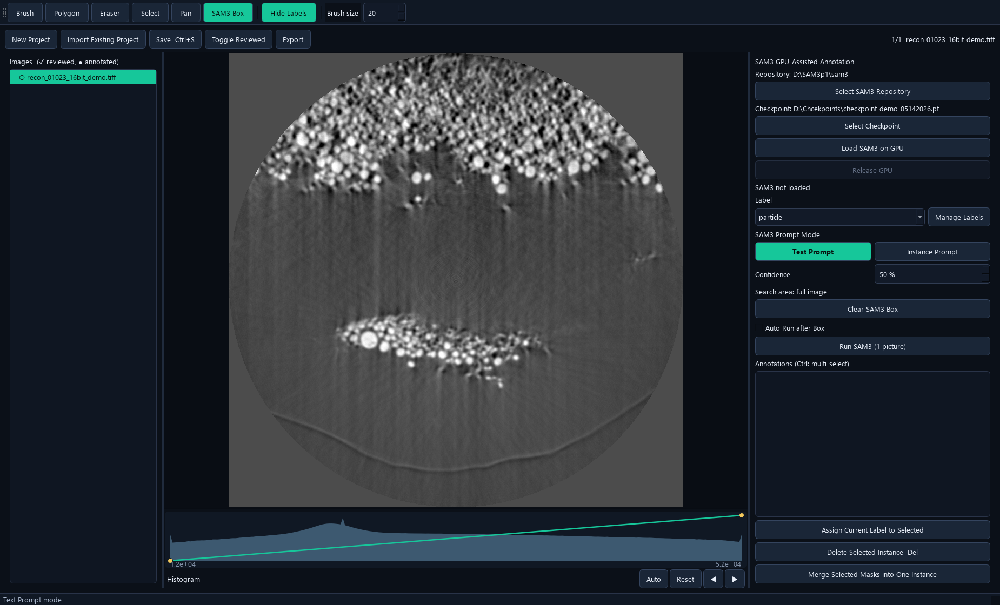

- 8-bit images can be supplied directly to SAM3; their original appearance is retained.
- For non-8-bit images, import prepares an RGB8 SAM3 input using the 0.1–99.9 percentile range, with full-range fallback for a flat percentile window.
- Display and SAM3 preparations are reused on later image switches. Adding images also runs background preparation.
- The .bl62_sam3_cache folder is beside the images. It contains generated previews, histogram metadata and, when needed, SAM3 input arrays.

**Note.** This is native-source preservation with mapped display and inference previews. Annotation does not rewrite the source intensities. Not every image encoding or multipage TIFF layout is guaranteed to be supported.

## 7. Histogram and Display Curve

Histogram controls are for viewing and manual annotation. They do not change the prepared SAM3 input or the saved source image.

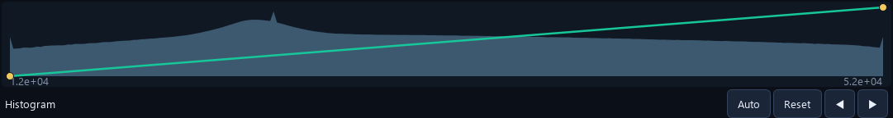

1. Load an image. The range is empty when no image is loaded, and follows the loaded image's grayscale range.
2. Drag the curve controls to change the visible brightness and contrast.
3. Use Auto for a 0.1–99.9 percentile display stretch.
4. Use Reset to restore the full image range.
5. Use Previous or Next immediately after Reset to change images.

**Note.** A dark or pale display is often a viewing-window issue. Adjust the display first; the histogram axis is not forced to 0–255 for a higher-bit source.

## 8. Labels and Categories

A label is an object/class name, such as particle. Each instance has one category; an image may contain instances from several categories.

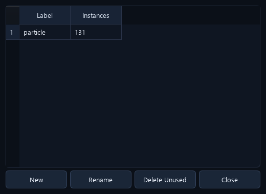

1. Choose the Label before drawing or running a Text Prompt.
2. Use Manage Labels → New to create a category, or Rename to change its name globally.
3. To relabel existing masks, select them, choose the intended Label and click Assign Current Label to Selected.
4. Use Delete Unused only for a category with no referenced annotations.

**Note.** Changing the Label dropdown alone sets the current drawing/prompt label. Use Assign Current Label to Selected to relabel existing selected instances. Category management and merging two object masks are different operations.

## 9. Manual Tools

- Brush size is measured in image pixels, rather than screen pixels.
- Select an existing instance before editing it. Brush with no selected instance creates a new object.
- Use L / Hide Labels to inspect the underlying image without changing masks.
- Very small completed annotations can trigger a delete confirmation.

| Tool | Use | Finish / exit |
| --- | --- | --- |
| Brush | Create an object or add pixels to the selected object | Enter or right-click finishes |
| Eraser | Remove pixels from the selected object | Enter or right-click finishes |
| Polygon | Click boundary points to create a mask | Enter or right-click closes it |
| Select | Select an object on the canvas | Esc clears the active tool/selection |
| Pan | Move the view; wheel zooms | Esc exits |
| SAM3 Box | Draw a rectangular SAM3 search region | Release the mouse; Auto Run may start |

## 10. Brush, Eraser and Interior Holes

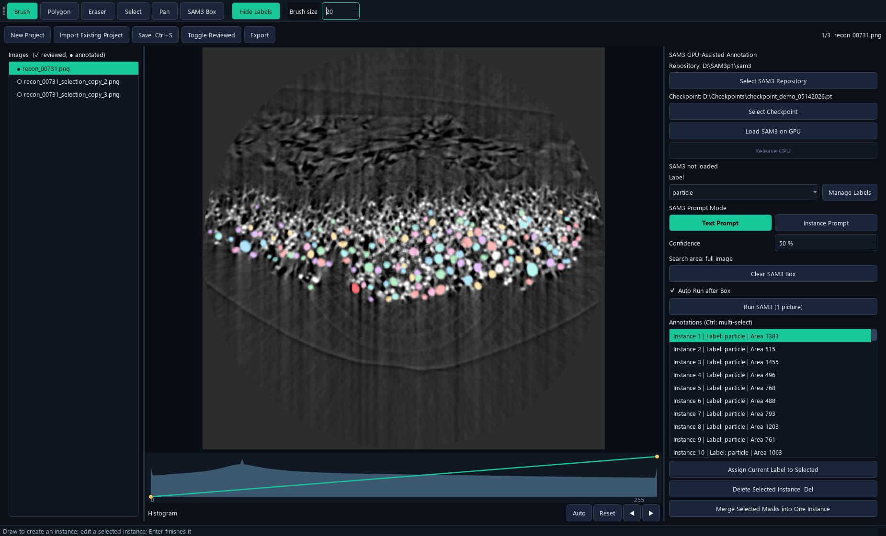

1. Select the target instance on the canvas or in the annotation list.
2. Use Brush to add missing pixels or Eraser to remove unwanted pixels, including an interior hollow region.
3. Press Enter or right-click to finish the edit and clear the active instance selection.
4. Use Ctrl+Z / Ctrl+Y if the change is wrong.
5. Save. Switch to another image and return when checking a corrected mask.

**Note.** Hollow and other non-polygon-safe masks are stored with lossless COCO RLE. Interior holes remain open after switching images and reopening the saved project.

## 11. Text Prompt: One Image

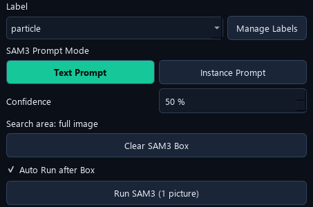

1. Select one image in the left list.
2. Choose a meaningful Label, for example particle, and select Text Prompt.
3. Set Confidence. The current default is 50%; a higher value accepts fewer low-confidence predictions.
4. Clear the box for full-image inference, or keep a box for a restricted search.
5. Click Run SAM3 (1 picture), confirm any replacement warning and wait.
6. Review and correct the returned masks before saving or marking Reviewed.

**Note.** The old manual's 131-mask result at 45% was a saved demonstration, not a guaranteed result. Counts depend on image, checkpoint, prompt and confidence.

## 12. Selected Images: Batch Run

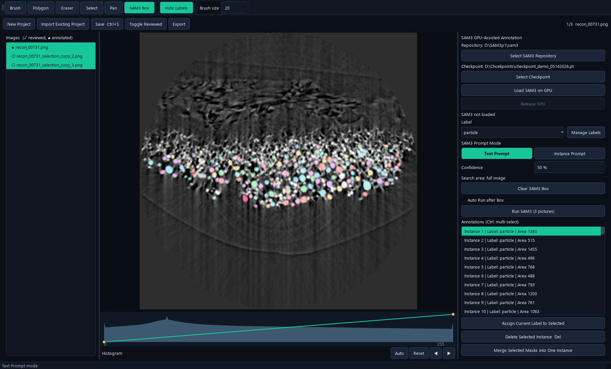

1. Use Ctrl-click or Shift-click in the image list to select the required images.
2. Set the Label/Text Prompt and confidence.
3. Click Run SAM3 (N pictures), or use the same action in the list's right-click menu.
4. Confirm that all existing labels on the selected images, including manual labels, will be replaced.
5. Wait for progress; each successfully completed image is saved automatically.

**Note.** Multi-image runs use full-image Text Prompt inference, without the current SAM3 Box or Instance Prompt. Cancel/failure keeps completed results and leaves unfinished images unchanged. A successful zero-detection result clears that image's labels; processed images become unreviewed.

## 13. Run Replacement versus Box Append

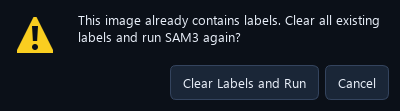

| Operation | Existing annotations |
| --- | --- |
| Ordinary Run, no box | Confirms replacement of all labels on this image |
| Ordinary Run, with box | Confirms removal of labels intersecting the box; outside labels remain |
| Multiple selected images | Confirms replacement of all labels on each selected image |
| Auto Run after Box | Appends detections; preserves all existing labels and overlaps |

**Note.** A label intersecting a replacement box is treated as an instance, not clipped into a retained outside fragment. Use the automatic box-append workflow when existing annotations must remain.

## 14. Continuous SAM3 Box Annotation

1. Select one image and choose Text Prompt or prepare an Instance Prompt.
2. Leave Auto Run after Box enabled; this is the default.
3. Choose SAM3 Box and drag over a search area.
4. Release the left mouse button. SAM3 automatically appends results for that box.
5. After completion, draw another box anywhere in the same image.
6. Use Undo to remove one completed addition, or Clear SAM3 Box to restore full-image scope.

- Existing manual and SAM3 labels are kept. Duplicate or overlapping labels are allowed.
- No replacement confirmation appears for this append operation.
- Turn Auto Run after Box off to draw or adjust a search rectangle without starting inference.
- Auto Box requires one selected image; a batch selection does not start box inference.

**Note.** Appending can intentionally create duplicate objects. Review and delete duplicates before training when they are not desired.

## 15. Instance Prompt: Reuse One Example

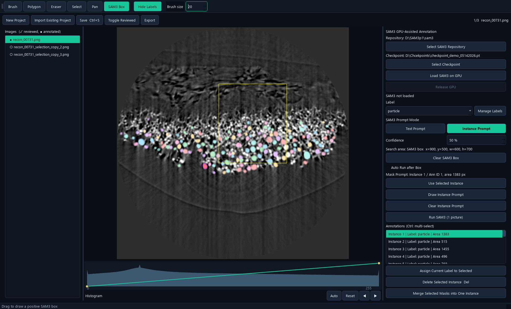

1. Select a representative existing object and choose Instance Prompt.
2. Click Use Selected Instance. The application copies the example mask and activates SAM3 Box.
3. Alternatively, use Draw Instance Prompt, finish the brush mask and choose whether it is also a formal annotation.
4. With Auto Run after Box on, draw consecutive boxes anywhere in the same image.
5. Use Clear Instance Prompt or choose a different example when needed.

**Note.** The example may lie outside a search box. Editing or deleting its original label does not change the frozen copy. Changing images clears the example; set it again for the new image. Results are clipped to the requested box.

## 16. Select, Delete, Merge and Relabel

1. Click an instance on the canvas or select its annotation-list row.
2. Ctrl-click annotation rows to select multiple instances.
3. Press Delete or click Delete Selected Instance to remove selected objects.
4. For fragments of one object, select at least two rows and use Merge Selected Masks into One Instance.
5. For a category change, choose the intended Label and use Assign Current Label to Selected.

| Operation | Result |
| --- | --- |
| Merge masks | One union mask; first selected instance's label is retained |
| Relabel instances | Masks remain; category/name changes |
| Delete instance | Removes the selected object annotation |
| Remove image from project | Removes the image reference and associated annotations |

**Note.** Undo/redo concerns the current image's mask edits. Switching images resets its edit history; save a working checkpoint before large review changes.

## 17. Save and Reviewed Status

Save writes the working project. Export creates a separate dataset package. Use each for its intended purpose.

1. Finish the current edit with Enter or right-click.
2. Press Ctrl+S or click Save Ctrl+S to write annotations.json.
3. After visually checking the image, click Toggle Reviewed.
4. Save again to preserve the review status.
5. Reopen annotations.json when continuing the same working project.

| Item | Stored information |
| --- | --- |
| annotations.json | Images, categories, instance masks and annotation metadata |
| project_state.json | Reviewed image IDs |
| backups/ | Project backup files created by the application |
| .bl62_sam3_cache/ | Regenerable display/SAM3 preparations, not ground-truth annotations |

**Note.** A Reviewed flag records your confirmation; it is not an automatic accuracy score. Ordinary manual edits should be saved explicitly; batch SAM3 saves successful images automatically.

## 18. Export a Training Dataset

1. Finish and save the working annotations.
2. Click Export and select an empty destination folder.
3. Wait for image copying, mask export and statistics to finish.
4. Use training_dataset/images together with training_dataset/annotations.json for downstream data preparation.
5. Open that JSON in Fine-tune GUI → Data, review it, assign Training/Validation and save a split dataset.

```text
export_folder/
  training_dataset/
    images/
    annotations.json
  auxiliary_outputs/
    instance_labels/
    previews/
    dataset_statistics.csv
    project_state.json
```

**Note.** The auxiliary label images and previews are for inspection; the COCO JSON carries the individual masks, including overlap and holes. A cancelled or incomplete export is marked and must not be treated as a completed training dataset.

## 19. Fast Workflow for One Image

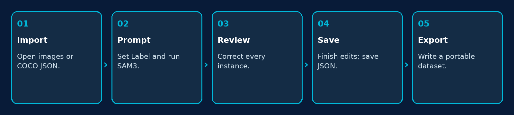

1. Drag the image into an empty GUI, or import its existing annotations.json.
2. Choose Label and Text Prompt; set confidence and click the single Run SAM3 button.
3. Correct missed/extra pixels and objects with Brush, Eraser and Delete.
4. Finish each instance. Inspect overlapping masks and hollow regions.
5. Save, mark Reviewed after inspection, and export when the dataset is ready.

**Note.** For local additions after a full-image run, use Auto Run after Box. This preserves completed manual work.

## 20. Updating, Moving and Checkpoint Management

1. Save and back up project JSON, source images and exported datasets.
2. Keep the old release until the new Windows folder has passed a small image test.
3. Install/update the dedicated application environment with the supplied script.
4. Verify the repository and shared checkpoint paths on the target computer.
5. Open a saved project, check a hollow mask, run one image and verify its exported annotations.

- Keep checkpoints in a central model folder rather than duplicating them into every GUI.
- Changing a file at an existing checkpoint path does not update a model already resident on the GPU. Release GPU, then load/run again.
- Keep a versioned backup of a previous checkpoint before centrally replacing it.
- Move the complete portable/application folder; the source launcher also needs its Conda environment.

**Note.** Manual edition 2026-10-26 replaces the old Setup/GPU Test and separate Run-button instructions. It documents import-time caching, original-range Histogram, resident SAM3, batch replacement and continuous box append.

## 21. Troubleshooting

| Symptom | Check / action |
| --- | --- |
| SAM3 cannot load | Verify repository root, compatible checkpoint, CUDA driver and installation log. |
| First Run is much slower | Model loading happens once. Later runs reuse the worker until it is released. |
| Brush edits the wrong object | Select the target instance first; finish the previous instance and inspect the selected list row. |
| A hollow region looks filled | Hide labels to inspect the source; check whether another overlapping instance covers the hole. Reopen the saved JSON to verify the individual mask. |
| Image switching / import is slow | Wait for cache preparation; confirm the dataset/cache drive is writable and has space. |
| High-bit image looks dark | Adjust Histogram / Auto. Source pixels and the prepared SAM3 input are not changed by display adjustments. |
| Box does not run | Check Auto Run after Box, a single image selection, a nonempty box, and an Instance Prompt if that mode is selected. |
| Unexpected duplicates after Box | Box Auto Run appends by design. Undo the last addition or delete unwanted duplicates. |
| No predictions | Check label wording, confidence, selected checkpoint and the search box. |
| Import cancelled | Wait for the worker to finish cancellation. The previously open project remains available. |

**Note.** Report the operation, image dimensions/bit depth, checkpoint name and full error text when requesting help. Preserve the working annotations before troubleshooting.

## 22. Keyboard Shortcuts and Terms

- Instance: one independently stored object mask. Category/Label: the class assigned to it.
- COCO RLE: a lossless binary-mask representation that preserves holes and disconnected regions.
- Confidence: the prediction acceptance threshold, not a guarantee of a correct scientific segmentation.
- Resident model: a model kept in GPU memory between annotation tasks.

| Shortcut | Action |
| --- | --- |
| B / P / E | Brush / Polygon / Eraser |
| S / H / G | Select / Pan / SAM3 Box |
| L | Show or hide labels |
| Enter / right-click | Finish the active brush/eraser instance or polygon |
| Esc | Exit active tool and clear selection |
| Delete | Delete selected instances |
| Ctrl+S | Save working project |
| Ctrl+Z / Ctrl+Y | Undo / Redo |
| Ctrl-click / Shift-click image list | Select individual images / an image range |
| Mouse wheel | Zoom the canvas |
